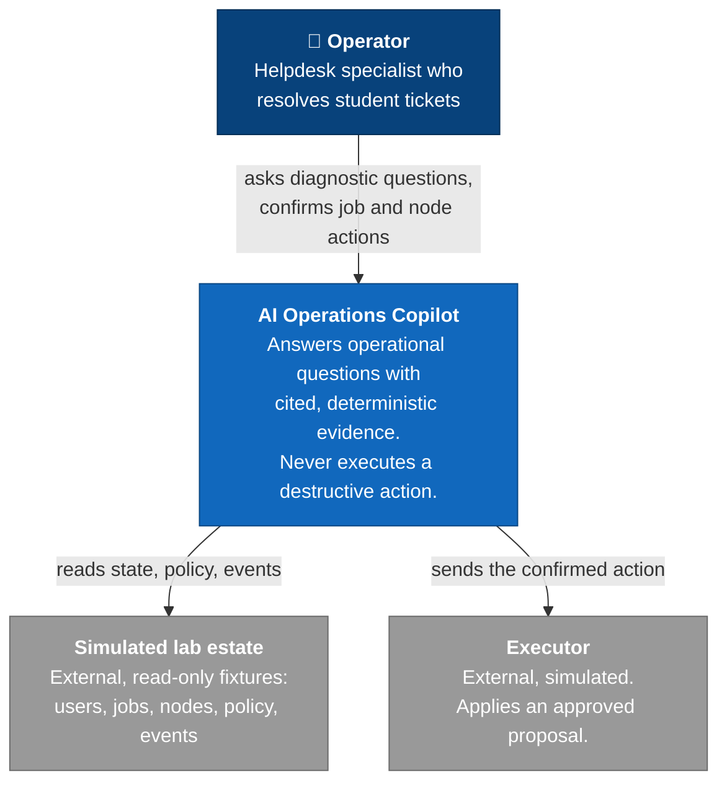
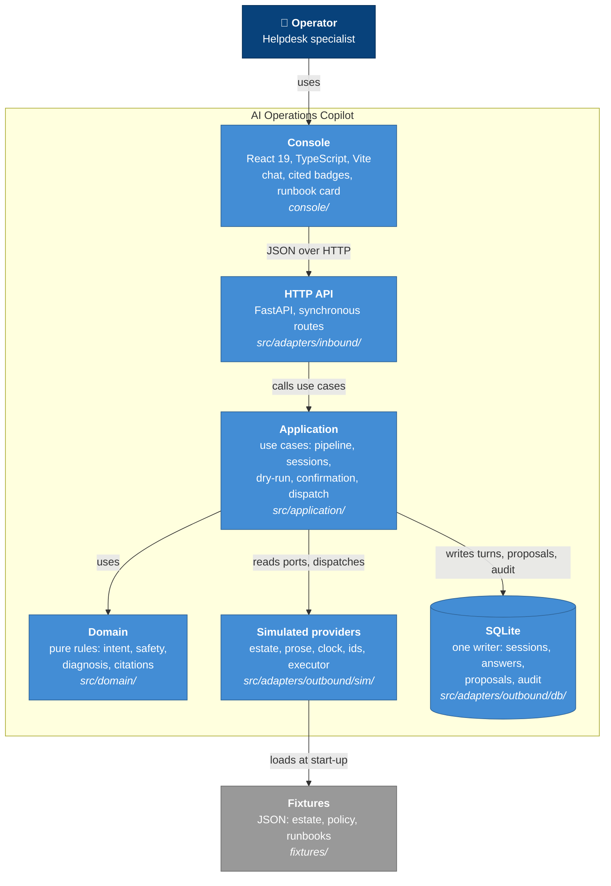

# C4 diagram: AI Operations Copilot (Module 12)

Levels 1 (context) and 2 (containers). They are drawn with plain Mermaid flowcharts in C4 style,
because the experimental Mermaid C4 syntax does not render reliably. The containers follow the
ports and adapters layout in `src/`. The domain imports no adapter (enforced by ruff `TID251` and
`tests/unit/test_architecture_imports.py`).

## Level 1: System context

## Level 2: Containers

