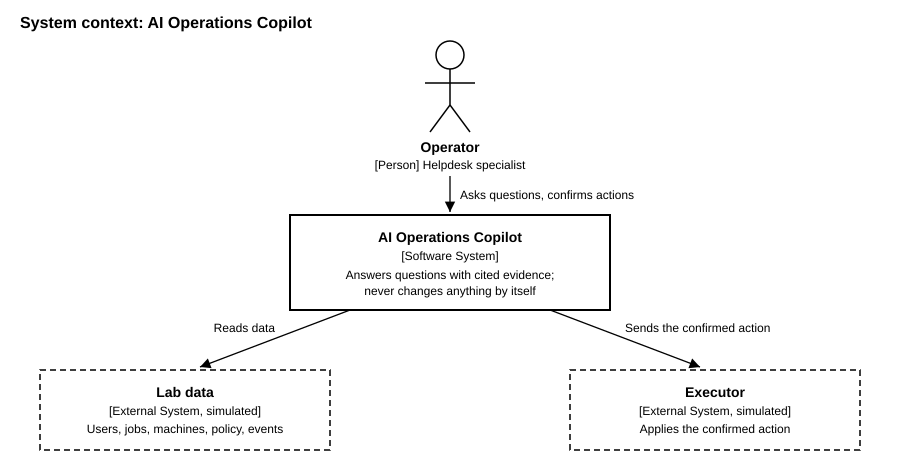
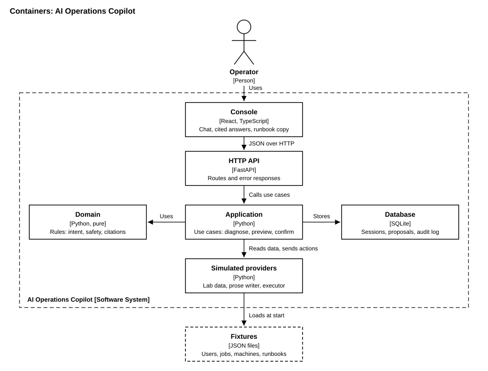

# C4 diagram: AI Operations Copilot (Module 12)

## Level 1: System context

## Level 2: Containers

The containers follow the ports and adapters layout in `src/`: the console is `console/`, the
HTTP API is `src/adapters/inbound/`, the application is `src/application/`, the domain is
`src/domain/`, the database is `src/adapters/outbound/db/`, and the simulated providers are
`src/adapters/outbound/sim/`. The domain imports no adapter (enforced by ruff `TID251` and
`tests/unit/test_architecture_imports.py`).
