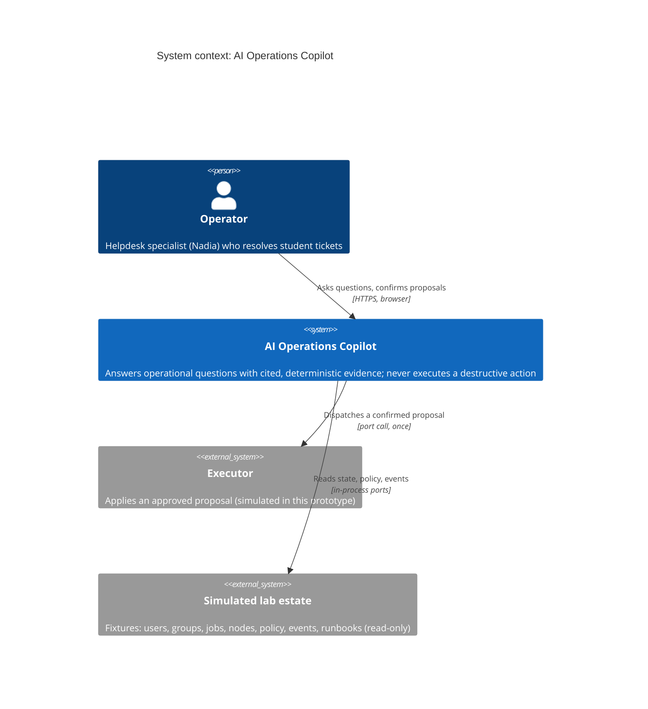
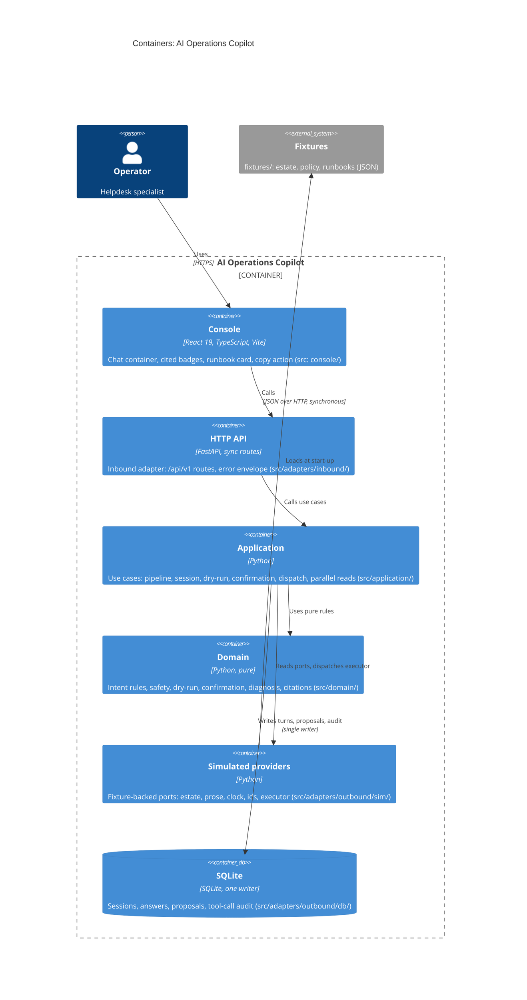

# C4 diagram: AI Operations Copilot (Module 12)

Levels 1 (context) and 2 (containers), in Mermaid C4 syntax. The containers follow the ports
and adapters layout in `src/`. The domain has no adapter imports (enforced by ruff `TID251` and
`tests/unit/test_architecture_imports.py`).

## Level 1: System context

## Level 2: Containers

