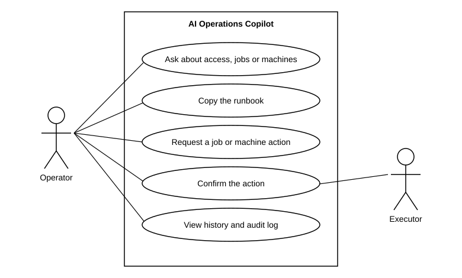

# Use case diagram: AI Operations Copilot (Module 12)

| Use case | Requirement | Story |
|---|---|---|
| Ask about access, jobs or machines | FR-01, FR-03, FR-04, FR-05, FR-07, FR-13 | 1-2, 1-3, 1-4, 3-1, 3-3 |
| Copy the runbook | FR-08 | 3-3, 1-7 |
| Request a job or machine action | FR-09 | 2-1, 2-2 |
| Confirm the action | FR-09, FR-10 | 2-3, 2-4 |
| View history and audit log | FR-02, FR-11, FR-12 | 1-2, 1-5 |
