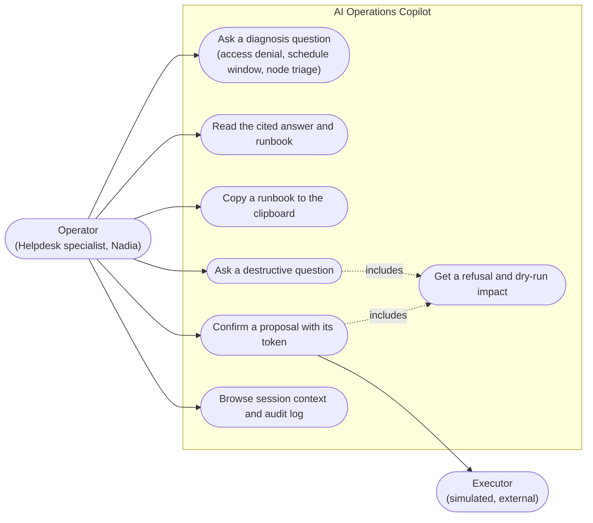

# Use case diagram: AI Operations Copilot (Module 12)

The operator asks the copilot questions about the simulated lab. The copilot answers from
deterministic evidence, and it never runs a destructive action itself. A destructive request
ends in a dry-run, a confirmation, and a hand-off to the executor.

| Use case | Requirement | Story |
|---|---|---|
| Ask a diagnosis question | FR-01, FR-03, FR-04, FR-05, FR-07 | 1-2, 1-3, 3-1, 3-3 |
| Read the cited answer and runbook | FR-13, FR-08 | 1-4, 3-3, 1-7 |
| Copy a runbook to the clipboard | FR-08 (console) | 1-7 |
| Ask a destructive question | FR-09 | 2-1 |
| Get a refusal and dry-run impact | FR-09 | 2-1, 2-2 |
| Confirm a proposal with its token | FR-09, FR-10 | 2-3, 2-4 |
| Browse session context and audit log | FR-02, FR-11, FR-12 | 1-2, 1-5 |
