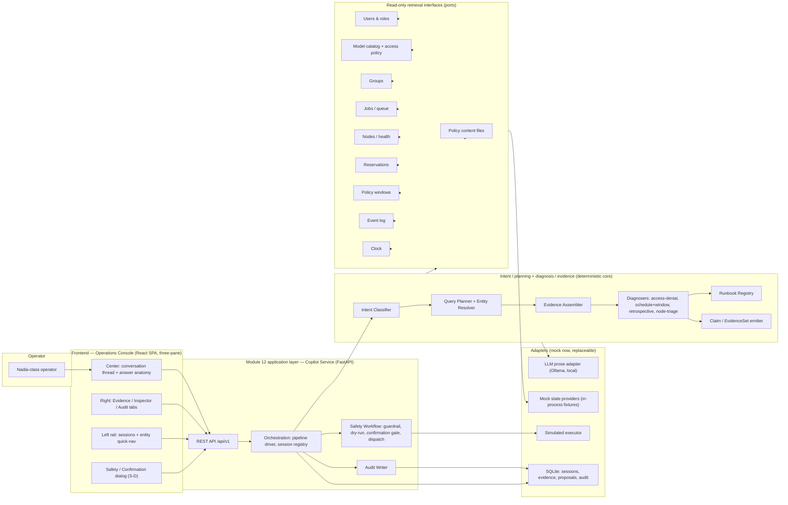
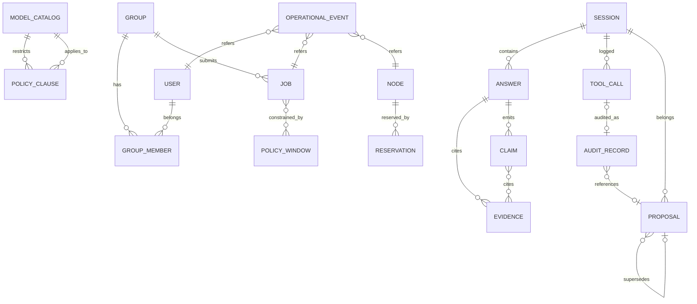
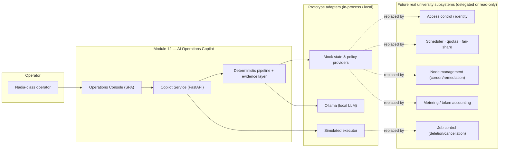
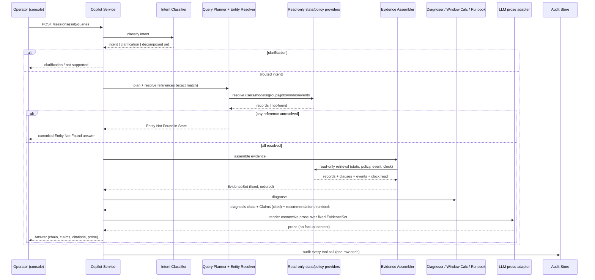
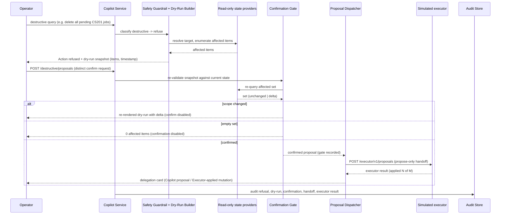
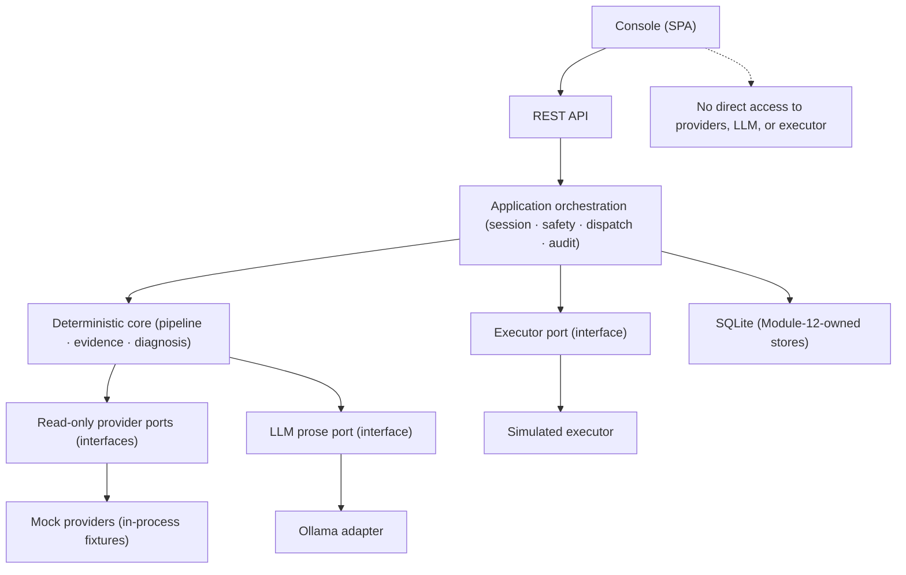

# Architecture — Module 12: AI Operations Copilot

> **Design brief (from the activation payload):** Module 12 is an **intelligence/diagnostic layer over a simulated or externally provided operational estate**. It owns conversational interaction, intent interpretation and query planning, evidence retrieval/orchestration, deterministic evidence-level diagnosis, citation generation, runbook recommendation, session/context handling, tool-call audit logging, safety guardrails for destructive requests, and dry-run/proposal generation. It does **not** own or execute authentication/authorization enforcement, GPU reservations, quotas/fair-share, job scheduling, policy enforcement, node cordon/uncordon, physical node remediation, job cancellation/deletion execution, metering/token accounting, model serving/training, or the authoritative system of record. The hardware brief (heterogeneous GPU fleet, 24 GB and 2×48 GB machines, Kubernetes as eventual abstraction) is represented **only as delegated/mocked interfaces**; Module 12 does not architect GPU scheduling or infrastructure management.

## Companion Artifacts (v2)

This document is the **architecture spine**: topology, invariants (AD-1..AD-15), stack, and the capability map. Implementation-level detail lives in three companion artifacts, linked here rather than restated:

| Companion | Owns | Read it for |
|---|---|---|
| [detailed-design/contracts.md](detailed-design/contracts.md) | Formal behavioral contracts — §0 type/enum vocabulary, §1 core-domain operations (P/Q/I clauses), §2 inbound-port operations, §3 outbound-port read contracts OP-1..OP-15, §4 typed error catalog, §5 invariants I1..I22 | exact operation signatures, canonical strings, error codes, pre/post-conditions |
| [detailed-design/ports-and-adapters.md](detailed-design/ports-and-adapters.md) | Hexagonal boundary rules — component table (every component once, with its ring tag), hard rules R1..R4 with enforcement points, layered component diagram | which ring a component lives in and which dependency edges are allowed |
| [detailed-design/schemas/](detailed-design/schemas/) | Concrete artifacts — `openapi.yaml` (ingress routes), `dto.py` (primitive-typed DTOs), `001_module12_copilot_schema.sql` (SQLite DDL + triggers), `events.schema.json` + `events.md`, `phase-2.3-cross-check.md` | generated schemas, fields, constraints, and the invariants carried as runtime/CI guards |

**Precedence.** Where this spine and a companion disagree on a **contract-level** detail (a field name, HTTP status, SQL constraint, or port signature), the companion is authoritative; where they disagree on an **invariant** (AD-n), this document is authoritative. The 2026-10-16 reviews (`reviews/review-arch-*.md`) were triaged into the companions via decisions **D52–D68** and reflected in the AD blocks below.

## 0. Design Paradigm

**Layered read-only intelligence layer over a deterministic evidence pipeline, expressed as hexagonal ports/adapters.**

The whole system is one process (backend) plus one SPA (console). The backend is three concentric rings with a strict dependency direction:

1. **Deterministic core** (innermost, pure): intent taxonomy + routing, query planning, entity resolution, evidence assembly, per-intent diagnosis, window calculation, runbook lookup, structured **Claim** emission. No I/O; no LLM; no notion of HTTP.
2. **Application ring** (middle): the Copilot Service orchestration — session registry, the safety workflow state machine, proposal dispatch, audit writing, the read-only provider ports, the LLM prose port, and the executor port as **interfaces**.
3. **Adapter ring** (outermost): mock state/policy providers (in-process fixtures), the Ollama prose adapter, the simulated executor, the clock, the SQLite stores, and the REST API consumed by the console SPA.

Dependency rule: **outer rings may call inner rings; inner rings never call outward.** The deterministic core never depends on any adapter, and the copilot never depends on a mutating port — the only mutating capability in the system is the **executor port**, callable solely by the Proposal Dispatcher and only for a confirmed proposal (AD-1, AD-3).

This is a named, boring pattern: the same shape every module boundary in the platform can rely on, small enough to run standalone, with the provider/executor/LLM adapters being the exact places real university subsystems slot in later.

## 1. Component Topology



### 1.1 Frontend / Operations Console

React 19 + TypeScript + Vite 8 SPA implementing the four surfaces from `SPECIFICATIONS.md` (S-A Console, S-B State Inspection Viewer, S-C Tool-Call Audit Log, S-D Safety/Confirmation). It holds **no** domain logic: it renders Answer resources, calls the REST API, renders retrieved content as bounded, un-styled data (FR-15), and renders the answer chain and canonical strings verbatim. The safety dialog is a client-side view over a **server-side** state machine (AD-4) — the client can never fabricate a "confirmed" or "dispatched" state.

### 1.2 Module 12 backend / application layer — Copilot Service

FastAPI service. Owns: request acceptance, session registry, pipeline driving, the safety workflow, proposal dispatch, and audit writing. It is the only process that owns Module 12's own stores (sessions, evidence, proposals, audit). It holds **no** operational state and **no** policy — those come exclusively through ports.

### 1.3 Intent / query-planning components

- **Intent Classifier** — maps a query to exactly one registered intent from the PRD §7.1.1 taxonomy, or to the clarification path, or decomposes a compound query (FR-01). Deterministic: rule-based matching over the taxonomy plus an LLM-assist **only** for ambiguous clarification, never for routing authority. Any compound query containing a destructive verb routes to clarification (FR-01, UX-04).
- **Query Planner + Entity Resolver** — extracts entity references and resolves them by **exact id** against the read-only provider index (FR-03). Unresolved references produce the literal canonical response. No LLM participates (AD-7).

### 1.4 State/policy retrieval interfaces

Read-only provider ports (interfaces) for the eight entity stores + clock + policy content (PRD §2.2, D2, C-4). Mock providers implement them in-process from fixture files; real university subsystems replace the **adapters only**, never the ports. The port surface is fixed to what registered intents require; adding a control-plane method is a PRD-scope change (AD-13). The port interface list and ring placement are owned by [`ports-and-adapters.md`](detailed-design/ports-and-adapters.md); the exact port signatures are `contracts.md` §3 OP-1..OP-15.

### 1.5 Diagnosis / evidence layer

- **Evidence Assembler** — runs the read-only retrievals for the routed intent and produces a fixed **EvidenceSet** (records + policy clauses + events + clock read) with a monotonic `position` per entry assigned at assembly time. This is the determinism boundary (D4, AD-2, AD-14).
- **Diagnosers** — per-intent pure functions (access-denial, schedule/window + window calculator, retrospective event, node-triage) that read the EvidenceSet and emit a **diagnosis class**, structured **Claims** (each bound to ≥ 1 citation into the EvidenceSet), and a recommendation.
- **Runbook Registry** — template-backed, error-code-keyed, with provenance + version (FR-08).

### 1.6 Runbook retrieval

`GET /api/v1/runbooks/{error_code}` over the Runbook Registry. Output is the registered template's step list verbatim; unknown code → literal `no runbook available for code X`; physical-intervention templates lacking approved-source metadata render unavailability (AD-9, UX-14).

### 1.7 Session / context

Server-side Session Store (SQLite). Typed context: resolved entities, prior intents, active answer ids. Bounded to the prototype's operational scope (FR-02); reset clears it; session context never authorizes a destructive action (AD-5).

### 1.8 Audit logging

Audit Writer + Audit Store (SQLite). One append-only row per copilot tool call; executor-applied mutations logged separately with `actor = executor` and no ToolCall (FR-10, FR-11). The Audit Writer is the single writer for all Module-12 persistence — it writes the Proposal's `executor_result` and the `actor = executor` audit row from the executor adapter's return value; the executor adapter holds no write handle to Module-12 stores (AD-10). Write-time redaction filter; retention cap with rotation of oldest (NFR-11, D15, AD-10).

### 1.9 Safety / proposal workflow

Server-side state machine over the proposal store: `refusal → dry-run → confirmed → dispatched → executed/failed/superseded`. Guardrail classifies destructive intents and refuses; Dry-Run Builder snapshots the affected-item set **and the selector predicate that produced it**, issuing a per-proposal gate token; Confirmation Gate records an explicit, distinct procedural confirmation, requires the gate token, and re-validates the snapshot against the stored selector; Proposal Dispatcher performs the single propose-only handoff (AD-3, AD-4, AD-6, AD-15).

### 1.10 Mock / external providers

In-process mock state providers seeded from fixtures; local Ollama LLM; simulated clock; simulated executor. All standalone (C-5, A-12).

### 1.11 Delegated executor boundary

The only write-capable boundary in the system: the executor contract `POST /executor/v1/proposals` (FR-10, C-6). Implemented by the simulated executor in the prototype; the schema is fixed by AD-15 and the simulated executor is the reference adapter — a real job-control subsystem swaps the **adapter implementation**, never the contract.

### 1.12 Deployment, environments & operations (prototype envelope)

- **Deployment:** one FastAPI process serving the REST API and the Vite-built console assets; one SQLite database file for Module-12-owned stores. The Ollama daemon runs locally (`127.0.0.1:11434`) with the prose model preloaded (`OLLAMA_KEEP_ALIVE=-1`) so the first answer of the day is not cold (NFR-7 cold-start ≤ 60 s).
- **Environments:** a single standalone environment for the prototype (C-5, A-12 — offline/local). No separate staging/prod split in scope; fixture snapshots make state reproducible across runs and machines.
- **Concurrency (NFR-6):** FastAPI async handles ≥ 5 concurrent operator sessions against in-process, per-session server state; SQLite uses WAL mode for concurrent reads with a single writer. Sessions are independent; no shared mutable pipeline state.
- **Latency (NFR-5):** the evidence pipeline is pure Python over in-process fixtures; the only network hop is the single prose call to local Ollama. p95 ≤ 3 s and p99 ≤ 8 s are prototype targets to be measured (OQ-8) — the LLM is prose-only over a fixed evidence payload, so it is not on the critical path for evidence assembly.
- **Availability (NFR-7):** 99% over an 8-hour window is met by the single-process design; fault-injection covers every dependency failure (FR-16, AD-12). No horizontal scaling in the prototype; the provider/executor/LLM ports are the scale-out seams for the real platform.

## 2. Data Model and Schemas

Only the entities the four scenarios + edge case require (D6). All IDs are stable strings matching the citation vocabulary (`user#alex`, `policy#catalog.4.2`, `node#ws-gpu-11`, `job#job-8823`, `event#evt-4711`). The authoritative field sets are `contracts.md` §0.3/§0.5; the physical DDL (constraints, enums, triggers) is [`schemas/001_module12_copilot_schema.sql`](detailed-design/schemas/001_module12_copilot_schema.sql).



### 2.1 Read/consume entities (operational estate — read-only, owned by mock providers or real subsystems)

| Entity | Key fields | Notes |
|---|---|---|
| `User` | `id`, `display_name`, `role` | `role` ∈ {student, staff, faculty, privileged} (minimal v1 set) |
| `Group` | `id`, `name`, `members[]` | `group-4` (S2) |
| `ModelCatalogEntry` | `id`, `name`, `allowed_roles[]` | `deepseek-coder` (S1) |
| `AccessPolicyClause` | `clause_id` (e.g. `policy#catalog.4.2`), `model_id`, `rule`, `reason_class`, `text` | reason_class ∈ {not-in-allowlist, quota, window} |
| `Job` | `id`, `group_id`, `course`, `status` ∈ {pending, running, succeeded, cancelled, failed}, `scheduling_constraint`, `created_at` | pending set for S4 dry-run |
| `Node` | `id`, `hostname`, `gpu_memory_gb`, `status` ∈ {available, reserved, active, fault}, `cordoned`, `error_code`, `health` | `ws-gpu-11` / `ERR_THERMAL_88` (S3) |
| `Reservation` | `id`, `node_id`, `start`, `end`, `purpose` | read-only (UX-21) |
| `PolicyWindow` | `window_id` (e.g. `night`), `applies_to` (job class), `start`, `end`, `timezone` | Night Policy fixture (A-10) |
| `OperationalEvent` | `event_id`, `type` ∈ {access_denied, job_cancelled, node_cordoned}, `entity_ref`, `timestamp`, `outcome`, `recorded_reason` | reason-on-event (D5, PD-2) |

### 2.2 Module 12-owned entities (SQLite)

| Entity | Key fields | Notes |
|---|---|---|
| `Session` | `session_id`, `created_at`, `operator_role` (synthetic), `context` (resolved_entities[], prior_intents[], active_answer_ids), `status` | FR-02 |
| `Answer` | `answer_id`, `session_id`, `query`, `intent`, `answer_chain` (reached stages), `diagnosis_class` or canonical response, `proposal_ref` | rendered by console |
| `Evidence` | `citation_id` (stable source `{type}#{id}`), `source_type`, `snippet`, `position` | unique, ordered per answer; clock reads are citable members (`clock#<read_id>`) (AD-14) |
| `Claim` | `claim_id`, `answer_id`, `text`, `claim_citations[]` (join to Evidence) | structured factual claim (AD-8) |
| `ToolCall` | `tool_call_id`, `session_id`, `tool_name`, `params_summary`, `timestamp`, `status` | redacted at write (NFR-11) |
| `AuditRecord` | `audit_id`, `tool_call_id?` (nullable), `session_id`, `operator_role`, `timestamp`, `result_summary`, `actor` ∈ {copilot, executor}, `proposal_id?` | append-only; `tool_call_id` set for copilot tool calls, null for executor-applied mutations (FR-10, AD-10) |
| `Proposal` | `proposal_id`, `session_id`, `state` ∈ {refused, dry_run, confirmed, dispatched, executed, failed, superseded}, `supersedes_proposal_id?` (self-FK), `dry_run_snapshot` (`selector` predicate, `affected_items[]`, `snapshot_timestamp`), `gate_token`, `confirmation` (`confirmed_at`, gate marker), `executor_result` (`status`, `applied_records[]`, `applied_count`, `timestamp`, `source=executor`) | the safety state machine (AD-4, AD-6, AD-15) |

## 3. API / Event Contracts

All contracts are **synchronous request/response HTTP**. The route tables below are a summary: the authoritative signatures and status bindings are `contracts.md` §2 and [`schemas/openapi.yaml`](detailed-design/schemas/openapi.yaml), with typed errors in `contracts.md` §4. There is **no event bus, queue, or messaging infrastructure** — dry-run re-validation is a pull-based re-query (UX-03), and nothing in the scenarios needs push notifications. `{entity_type}` ∈ {users, catalog, policy, groups, jobs, nodes, reservations, windows, events} — the canonical enum matches the provider-port surface 1:1 (models are `catalog` entries, policy clauses are `policy`, policy windows are `windows`); `GET /api/v1/state/{entity_type}?q=` matches using the same case-folded exact-id normalization as AD-7.

### 3.1 Conversational investigation

| Route | Purpose | Key FR |
|---|---|---|
| `POST /api/v1/sessions` | create session | FR-02 |
| `POST /api/v1/sessions/{sid}/queries` | submit query → `Answer` resource (chain, diagnosis, claims, citations, recommendation/proposal) | FR-01, FR-04–08 |
| `GET /api/v1/sessions/{sid}` | session context + turn list | FR-02 |
| `DELETE /api/v1/sessions/{sid}` | reset/clear session | FR-02 |

### 3.2 State inspection

| Route | Purpose | Key FR |
|---|---|---|
| `GET /api/v1/state/{entity_type}/{id}` | raw record, field-for-field | FR-12 |
| `GET /api/v1/state/{entity_type}?q=` | browse list (left-rail nav) | FR-12 |

### 3.3 Evidence / citation retrieval

| Route | Purpose | Key FR |
|---|---|---|
| `GET /api/v1/answers/{aid}/evidence` | the EvidenceSet for an answer | FR-13 |
| `GET /api/v1/citations/{cid}` | a citation's source record + snippet | FR-13 |

### 3.4 Runbook retrieval

| Route | Purpose | Key FR |
|---|---|---|
| `GET /api/v1/runbooks/{error_code}` | registered template + provenance/version | FR-07, FR-08 |

### 3.5 Tool-call / audit inspection

| Route | Purpose | Key FR |
|---|---|---|
| `GET /api/v1/sessions/{sid}/audit?page=&page_size=` | paged append-only log, honoring the retention cap | FR-11 |

### 3.6 Destructive-action dry-run / proposal

| Route | Purpose | Key FR |
|---|---|---|
| `POST /api/v1/destructive/dry-runs` | classify + refuse + build dry-run snapshot (affected items, timestamp) | FR-09 |
| `POST /api/v1/destructive/proposals` | procedural confirm + re-validate snapshot → confirmed proposal (and dispatch) | FR-09, FR-10 |
| `GET /api/v1/destructive/proposals/{pid}` | proposal + executor result | FR-10 |
| `POST /api/v1/destructive/proposals/{pid}/re-dispatches` | new proposal (fresh dry-run + confirmation), per PD-6 | FR-10 |

### 3.7 Confirmation / delegation boundary (executor contract)

| Route | Owner | Purpose |
|---|---|---|
| `POST /executor/v1/proposals` | simulated executor (external/simulated) | propose-only handoff; applies the mutation only post-gate; result logged executor-originated |
| `GET /executor/v1/proposals/{pid}` | simulated executor | executor status/result |

This route set is the **replacement point** for the real job-control subsystem (OQ-3): Module 12 never changes when the simulated executor is swapped for the real one, as long as the schema holds.

## 4. Mermaid Diagrams

### 4.1 Context Diagram



### 4.2 High-Level Component Interaction — the investigation flow



### 4.3 Destructive-action flow (safety state machine)



### 4.4 Dependency direction (who may depend on whom)



## 5. Architectural Invariants

All invariants are machine-enforceable (schema constraints, middleware, static checks, or deterministic tests). Each is tagged `[ADOPTED]` — they are settled by the PRD decisions D1–D15 and the UX decisions D16–D22, not invented here.

### AD-1 — Read-only state boundary

**Status:** `[ADOPTED]` (D2, C-1, S-6, FR-10, NFR-8)

**Binds:** All state/policy provider ports, the deterministic core, the application ring, the Proposal Dispatcher, the executor port.

**Prevents:** The Copilot ever writing to operational state, becoming the authoritative system of record, or executing mutations directly.

**Rule:** Every access to operational state or policy passes through a read-only provider port whose interface declares only query methods and no mutating methods. The only interface in the system that applies mutations is the executor port; the only component that may call it is the Proposal Dispatcher; the Dispatcher calls it at most once per confirmed proposal. The codebase contains zero calls that write to a state/policy store outside the executor adapter.

**Trade-off:** Module 12 cannot correct state, act autonomously, or mutate anything — every corrective action requires a delegated executor and a confirmed proposal, adding a hop for anything beyond diagnosis.

### AD-2 — Evidence-level determinism via retrieval-composition

**Status:** `[ADOPTED]` (D4, C-2, FR-14, NFR-4, PD-1)

**Binds:** Evidence Assembler, Diagnosers, Window Calculator, Claim/EvidenceSet emitter, LLM prose adapter, determinism tests.

**Prevents:** Evidence set, citations, diagnosis class, or runbook steps varying across identical runs, or being influenced by LLM nondeterminism.

**Rule:** Given identical (query, resolved entities, state snapshot, policy content, configuration, clock read), the EvidenceSet is produced by deterministic code with a monotonic `position` per entry (AD-14); the diagnosis class, Claims, citations, and runbook steps are computed by pure functions over that EvidenceSet; the LLM is invoked exactly once **for prose composition** per answer and its output is used only as connective prose. The Intent Classifier is rule-based in v1 and never emits diagnosis, claim, or citation content; an LLM-assist, if any, is limited to clarification prompts. No diagnosis, claim, citation, or recommendation field is ever read from LLM output. Determinism is asserted by the FR-14 test (3× runs → identical evidence membership, position sequence, citation set, diagnosis class, and runbook steps).

**Trade-off:** The LLM cannot add nuance, facts, or recomposition to the diagnosis; answers are largely templated over structured Claims, which caps prose quality in exchange for auditability.

### AD-3 — Propose-only action model; no execution path

**Status:** `[ADOPTED]` (D3, FR-10, C-6)

**Binds:** Safety workflow, Proposal Dispatcher, executor port, Proposal store.

**Prevents:** The Copilot executing a mutation even after confirmation, double-dispatch, or dispatch without a confirmed proposal.

**Rule:** A proposal may be dispatched only when its stored state is `confirmed` (set only by the Confirmation Gate). Each confirmed proposal yields exactly one executor call. A second dispatch attempt for the same proposal id is rejected. A re-dispatch is a new proposal with its own dry-run and confirmation (PD-6); the parent proposal's state is set to `superseded` unless it already applied, and the new proposal records `supersedes_proposal_id`. Destructive turns are recorded in session context like any other turn; the Confirmation Gate never consults session context (AD-5). Copilot-originated writes to operational state are 0 across the scenario suite (NFR-8).

**Trade-off:** A confirmed destructive action still requires a separate executor hop; the Copilot cannot "finish the job" it was asked to do, even with full confirmation.

### AD-4 — Server-side ordered safety state machine

**Status:** `[ADOPTED]` (FR-09, S-1, UX-01/02/03/07/26)

**Binds:** Safety workflow, Proposal store, destructive API routes, console S-D.

**Prevents:** The client or a forged request skipping stages, dispatching before confirmation, dry-running on an unresolved target, or confirming a no-op.

**Rule:** The server persists the flow state `refusal → dry_run → confirmed → dispatched → executed/failed/superseded` in the Proposal store and advances it only in that order. A destructive target that does not resolve returns `Entity Not Found in State` before any dry-run. A dry-run with an empty affected set disables confirmation. A dispatch request is rejected unless the server holds a `confirmed` proposal referencing a validated, non-empty dry-run snapshot. A compound query containing a destructive verb routes to clarification, never to decomposition. A session reset cancels in-flight requests and returns any destructive flow to its refusal/dry-run stage; it never auto-continues a destructive flow after reset (UX-08). The confirm control is disabled while snapshot re-validation is pending (UX-26).

**Trade-off:** No single-request "confirm and execute"; the destructive flow always takes multiple round trips, and the operator cannot short-circuit it.

### AD-5 — Confirmation is a procedural gate, not authorization

**Status:** `[ADOPTED]` (D9, C-8, A-13)

**Binds:** Confirmation Gate, Session store, destructive API routes.

**Prevents:** Session context, operator role, or UI presence being treated as administrative authority, or authorization semantics creeping into the safety flow.

**Rule:** The confirmation is a distinct HTTP request from the original query. The server records no identity or role claim on the confirmation; the confirmation payload contains only a proposal reference and a gate token. Session context is never consulted by the Confirmation Gate. The confirmation renders the fixed caption "This confirms a proposal for delegation. It does not grant or assert authorization."

**Trade-off:** V1 provides no real administrator verification — anyone with console access can confirm; real identity/authorization is deliberately deferred to an external subsystem (OQ-4).

### AD-6 — Dry-run snapshot re-validation before dispatch

**Status:** `[ADOPTED]` (FR-09, FR-10, UX-03, UX-26)

**Binds:** Dry-Run Builder, Confirmation Gate, Proposal store, destructive API routes.

**Prevents:** Dispatching a proposal whose affected-item set is stale relative to current state.

**Rule:** The Dry-Run Builder persists the **selector predicate** — the exact provider query (method + parameters) — that produced the affected list, inside the dry-run snapshot. At confirmation time the Confirmation Gate re-executes the stored selector and compares on `(id, actionable status)`: any change in the id set or in any item's actionable field refuses dispatch and returns a re-rendered dry-run with the delta surfaced and confirmation disabled. The Gate never re-derives the predicate from query text. Dispatch occurs only when the re-queried set matches the snapshot on that key. If the provider is unavailable during re-validation, the Gate returns the safe-failure response and performs no dispatch.

**Trade-off:** A confirmation can be rejected or delayed if operational state changes between the dry-run and the confirm, or if the provider is down at confirm time, forcing re-review or a safe-failure.

### AD-7 — Deterministic, exact-match entity resolution

**Status:** `[ADOPTED]` (FR-03, D13, PD-3, NFR-2)

**Binds:** Query Planner + Entity Resolver, provider index, diagnosis gate.

**Prevents:** Fabricated entities, partial resolution, LLM-guessed references, and typo-tolerant guesses.

**Rule:** The resolver canonicalizes every reference to a typed key `{type}#{id}` (bare names type-scoped by intent requirements), then compares exactly under a fixed case-folding rule (normative: case-fold, no fuzzy). Follow-up references resolve against session context first, then against the provider index (FR-02). Any unresolved reference yields the literal response `Entity Not Found in State` naming each unresolved reference, and no diagnosis proceeds. Diagnosis begins only when every required reference resolves to exactly one record. The `?q=` browse parameter uses the same normalization. The LLM is never consulted during resolution.

**Trade-off:** No fuzzy/typo tolerance in v1 (deferred, PD-3); misspellings and case variants outside the fold rule are surfaced as Entity-Not-Found rather than corrected.

### AD-8 — Structured claims with citation binding

**Status:** `[ADOPTED]` (FR-13, D4, PD-1, UX-12, UX-25)

**Binds:** Claim/EvidenceSet emitter, evidence renderer, Answer resource, citation API.

**Prevents:** Uncited factual claims, broken citations rendering as evidence, and free-form prose carrying facts that escape the FR-13 rubric.

**Rule:** Every factual claim in an answer is a structured `Claim` emitted by deterministic code and binds ≥ 1 citation through a `claim_citations` join; each citation id is a stable source reference `{type}#{id}` resolving to a unique, ordered EvidenceSet entry (AD-14). The renderer refuses to render a citation whose source record is not present in the EvidenceSet; on any such failure the answer downgrades at answer level to the literal `Cannot confirm (insufficient evidence)` — the rendered diagnosis is replaced by the literal listing what was checked and offering escalation (S-3), while the stored Answer retains its claims and evidence for audit. Prose is guarded: the pipeline scans LLM prose against the EvidenceSet token vocabulary (entity ids, clause ids, values, clock-derived facts) and strips or rejects any hit before render, so factual assertions cannot escape into prose un-cited. Citation coverage is checked both over the `Claim` set and over the rendered answer text (FR-13 rubric).

**Trade-off:** Answers are composed from structured claims and prose is token-scanned, so the LLM cannot weave facts into flowing prose; the factual content is rigidly templated and every rendered assertion is verifiable.

### AD-9 — Runbook output comes only from registered templates

**Status:** `[ADOPTED]` (FR-07, FR-08, D14, S-4, UX-14, UX-23)

**Binds:** Runbook Registry, runbook API, node-triage diagnoser.

**Prevents:** Invented remediation steps, wrong-template matching on a code the node does not report, and rendering unvetted physical-intervention content.

**Rule:** The node-triage diagnoser confirms the node record's cordon status and recorded error code against the query before lookup; a mismatch routes to `no runbook available for the recorded code`. Runbook output is the registered template's ordered step list, verbatim. The runbook registry response has two sections — `steps` (template verbatim) and `provenance` (metadata object); provenance is never merged into steps. Lookup is by exact error code. An unknown code returns the literal `no runbook available for code X`. A template whose physical-intervention steps lack approved-source metadata renders unavailability, not the steps. Each template carries provenance + version, which are rendered and audited.

**Trade-off:** New remediation guidance requires a registry entry and institutional approval; the Copilot cannot propose steps for codes without a template.

### AD-10 — Append-only audit with redaction and retention

**Status:** `[ADOPTED]` (FR-11, NFR-11, D15, S-5)

**Binds:** Audit Writer, Audit Store, audit API, tool-call interception.

**Prevents:** Audit tampering, secret leakage into the log, and unbounded log growth.

**Rule:** Exactly one audit record is written per copilot tool call; every executor-applied mutation is written with `actor = executor`, `proposal_id`, and null `tool_call_id`. The Audit Writer is the single writer for all Module-12 persistence — it writes the Proposal's `executor_result` and the executor audit row from the executor adapter's return value; the executor adapter holds no write handle to Module-12 stores. The Audit Store schema denies update and delete (enforced by a SQLite trigger; `sqlite3.sqlite_version` asserted ≥ 3.35 at startup); the audit API exposes no update/delete control. The Audit Writer applies a redaction filter at write time that drops credentials, tokens, and secrets (patterns: `api_key`, `token`, `secret`, `authorization` headers, `bearer <token>`); entries carry operator id (synthetic), session id, tool metadata, and query-derived entity ids only. The log honors a configured retention cap by rotating the oldest entries first; paging in the audit API never exceeds the cap.

**Trade-off:** Audit entries cannot be corrected or expunged (append-only); the retention cap means older history is dropped rather than retained indefinitely.

### AD-11 — Content data-hygiene: retrieved content is data, never control

**Status:** `[ADOPTED]` (FR-15, D11, C-7, S-7)

**Binds:** Intent Classifier, prompt assembly, evidence renderer, console S-A/S-B.

**Prevents:** Prompt injection or retrieved-content-driven behavior steering the Copilot's control flow, tools, or safety path.

**Rule:** Routing and control flow depend only on the intent taxonomy, registered handlers, and configuration. Retrieved content and query text are serialized as data objects; the console renders them bounded, mono, un-styled, and non-executable. The LLM prompt places retrieved content only inside delimited data sections copied verbatim. The injection corpus test asserts 100% behavioral parity between clean and injected fixtures and zero effect on the destructive path.

**Trade-off:** The system cannot respond to content that suggests new tools, intents, or behavior — any such extension requires a code/config change, never retrieved content.

### AD-12 — Safe failure on any dependency

**Status:** `[ADOPTED]` (FR-16, D12, S-8)

**Binds:** Every pipeline stage, provider ports, LLM port, executor port, clock.

**Prevents:** Fabricated or partial diagnosis, runbook, or window on dependency failure.

**Rule:** Each pipeline stage returns a typed result (`ok | failure`); any dependency failure (LLM timeout, state-provider failure, policy-source failure, clock failure, malformed input, executor unavailability) at any stage aborts the pipeline before prose and returns the literal degraded response (`Provider unavailable — cannot answer.` or `Cannot confirm (insufficient evidence)` as applicable). No partial evidence is emitted after a failure, and no window or runbook is produced from a failed read. Fault-injection tests cover every failure class with zero fabricated detail (FR-16).

**Trade-off:** One failed dependency fails the entire answer; there is no partial degradation that keeps the readable parts while dropping the broken part.

### AD-13 — Module 12 never expands into the platform's control plane

**Status:** `[ADOPTED]` (D1, PRD §2.4, §16, C-4)

**Binds:** Provider port surface, API route table, codebase boundaries.

**Prevents:** The Copilot silently becoming a scheduler, enforcer, meter, or node manager.

**Rule:** The read-only provider ports expose only the query surface required by the registered intents over one canonical entity-type enum — {users, catalog, policy, groups, jobs, nodes, reservations, windows, events} — plus clock and policy content. No port method performs scheduling, reservation, quota/fair-share, metering, node cordon/remediation, or enforcement. The API route table exposes no state-mutating route outside the destructive proposal flow. Adding a new entity type follows the documented extension path — a new read-only port + registry/config entry, no console change (NFR-10). Adding a capability beyond the registered surface is a PRD-scope change requiring an updated PRD, not a code change.

**Trade-off:** Module 12 cannot answer questions that require operational data outside the registered port surface, and cannot grow capabilities without a scope decision.

### AD-14 — Citation identity and evidence ordering

**Status:** `[ADOPTED]` (FR-13, FR-14, D4, UX-12)

**Binds:** Evidence Assembler, Claim emitter, evidence/citation APIs, evidence renderer.

**Prevents:** Two teams building incompatible citation/evidence shapes, the clock read being un-citable, and evidence ordering being undefined for FR-14 and the rendered evidence strip.

**Rule:** `citation_id` is a stable source reference `{type}#{id}` (the §2 vocabulary). The EvidenceSet is a unique, ordered set of sources per answer, persisted with `(answer_id, citation_id)` uniqueness and a monotonic `position` assigned at assembly time; a source cited by two claims is rendered once, carrying both claims' chips. Claims bind to sources through a `claim_citations` join, never a single FK column. Every EvidenceSet member — including the clock read, cited as `clock#<read_id>` — is citable by claims. FR-14 compares (a) the evidence membership set and (b) the position sequence as separate assertions.

**Trade-off:** A source reused across claims renders once, so the evidence strip is more compact but per-claim grouping must be derived from the join.

### AD-15 — Executor contract is frozen; the adapter is the replacement point

**Status:** `[ADOPTED]` (FR-10, C-6, PD-6, UX-05, UX-06)

**Binds:** Proposal Dispatcher, executor port, simulated executor, Proposal store, Audit Writer.

**Prevents:** Two executor implementations diverging, the executor re-deriving the dry-run scope, a dispatch that cannot prove the confirmation gate, and a double-apply rendering as a second success.

**Rule:** The `POST /executor/v1/proposals` payload is a fixed JSON schema: `proposal_id`, a closed-verb `action`, the persisted `selector` from the dry-run snapshot, the `gate_token` forwarded verbatim, and a reference to the dry-run snapshot by `proposal_id`. The executor must not re-enumerate the affected set — it applies exactly the referenced snapshot's items. The response is a fixed shape: `status`, `applied_records[]`, `applied_count`, `timestamp`. The Dry-Run Builder issues a per-proposal opaque `gate_token` returned in the dry-run response; the confirm request must echo it; the Dispatcher forwards it verbatim; the executor validates it. The Audit Writer rejects a second applied record for the same `proposal_id` (UX-06), surfacing it as executor failure, never a second success. The simulated executor is the reference adapter; a real job-control subsystem swaps the adapter implementation, never the contract.

**Trade-off:** The real executor must conform to this schema (including validating the gate token), which constrains how a real job-control subsystem integrates.

## Consistency Conventions

| Concern | Convention |
|---|---|
| Naming (entities, files, interfaces, events) | Entity ids use `{type}#{id}` (`user#alex`, `policy#catalog.4.2`, `job#job-8823`, `event#evt-4711`, `clock#<read_id>`); provider ports named `<entity>_store_port`; no "agent"/"skill" naming for pipeline stages; `{entity_type}` enum fixed to {users, catalog, policy, groups, jobs, nodes, reservations, windows, events} |
| Data & formats | Timestamps ISO-8601 UTC; ids are stable strings (never re-generated per run); `answer_chain` is an ordered array of stage codes from the closed enum `[observation, evidence, diagnosis, recommendation, proposal, execution]`; error/answer envelopes carry the stage list; canonical strings verbatim (`Entity Not Found in State: {ref_list}.`, `Cannot confirm (insufficient evidence): checked {checked_list}.`, `Provider unavailable — cannot answer.`, `Action refused.`, `no runbook available for code {code}.`, `This confirms a proposal for delegation. It does not grant or assert authorization.`) — literals byte-identical to `contracts.md` §4 (D57) |
| State & cross-cutting | Canonical strings are data owned by the deterministic core — a single core-side `canonical_strings` constant module is the only source; the core emits the literal in the answer payload; the renderer never re-words or maps codes. Entity resolution canonicalizes to `{type}#{id}` then compares exactly, case-folded, no fuzzy (AD-7). Operational state is read-only (AD-1); Module 12-owned stores are the only writable stores (SQLite, single Audit Writer — AD-10); every answer references its session; proposal flow is a persisted server-side state machine (AD-4); the executor contract is frozen (AD-15) |

## Stack Decisions

Seed — verified current at authoring (2026-09-27); the code owns the exact pins once it exists.

| Concern | Decision | Binding / notes |
|---|---|---|
| Language (backend) | Python 3.11 (3.11.16+) | deterministic core is plain Python — no ORM, no agent framework; matches FastAPI + stdlib `sqlite3` |
| Web framework | FastAPI 0.141.x on Uvicorn (`fastapi[standard]`) | single backend process serving `/api/v1` + `/executor/v1`; async handlers for NFR-6 |
| Language / UI (frontend) | TypeScript 6.x + React 19.x | console SPA; holds no domain logic (§1.1) |
| Build tool (frontend) | Vite 8.x | single SPA served by the FastAPI process (§1.12) |
| Persistence engine | SQLite (stdlib `sqlite3`), WAL mode, single writer | one DB file for the Module-12-owned stores (sessions, evidence, proposals, audit); no ORM; append-only audit enforced by a trigger — assert `sqlite3.sqlite_version` ≥ 3.35 at startup (AD-10) |
| Test framework | pytest (+ `pytest-asyncio`, `httpx` TestClient) | carries the four required suites under `tests/`: determinism (FR-14), citation coverage (FR-13), fault-injection (FR-16), injection corpus (FR-15) |
| Time source | **Clock port (adapter) — mandatory** | All time reads go through the Clock port (P9). The deterministic core never calls `datetime.now()`/`time.time()`. A simulated, freezable clock adapter is the only time source; freezing it is what makes AD-2/FR-14 determinism testable. Every component with time rules — window calculator, schedule diagnoser, dry-run `snapshot_timestamp`, audit and executor timestamps — receives the Clock port and never reads the wall clock directly (DP-5). Any new module carrying time rules must take the Clock port. |
| LLM runtime | Ollama 0.34.x (local) | prose-only, reached through the LLM prose port (§1.4); preloaded locally with `OLLAMA_KEEP_ALIVE=-1` (§1.12) |

The backend is a single FastAPI process; the console is a single Vite-served SPA. No queue, broker, or cache product is used (AD/proportionality).

## Structural Seed

```text
module12/
  console/                  # React 19 + TS + Vite 8 SPA
    src/surfaces/           # S-A console, S-B inspector, S-C audit, S-D safety
    src/api/                # typed REST client (no domain logic)
  service/                  # FastAPI Copilot Service
    api/                    # route handlers (/api/v1, /executor)
    application/            # orchestration: pipeline driver, session, safety, dispatch, audit
    core/                   # deterministic pipeline (no I/O)
      intent/               # taxonomy, classifier, query planner, entity resolver
      evidence/             # assembler, claim/evidenceset emitter, claim_citations join
      strings/              # canonical_strings constant module (single owner of literals)
      diagnose/             # access-denial, schedule+window, retrospective, node-triage
      runbooks/             # registry
    ports/                  # read-only provider interfaces, llm port, executor port
    adapters/               # mock providers (fixtures), ollama, simulated executor, clock, sqlite
  fixtures/                 # state snapshots, policy content, runbook templates
  tests/                    # determinism (FR-14), citation coverage (FR-13), fault-injection (FR-16), injection corpus (FR-15)
```

## Capability → Architecture Map

| Capability (PRD) | Lives in | Governed by |
|---|---|---|
| Conversational intake & routing (FR-01) | Intent Classifier + REST queries | AD-11, AD-7 |
| Session context (FR-02) | Session store | AD-5 |
| Entity resolution / anti-fabrication (FR-03) | Query Planner + Entity Resolver + providers | AD-7 |
| Access-denial / schedule / retrospective diagnosis (FR-04–06) | Diagnosers over EvidenceSet | AD-2, AD-8 |
| Runbook triage & source rule (FR-07–08) | Runbook Registry | AD-9 |
| Destructive refusal/dry-run/confirmation (FR-09) | Safety workflow + Proposal store | AD-4, AD-5, AD-6 |
| Propose-only handoff (FR-10) | Proposal Dispatcher + executor port | AD-1, AD-3, AD-15 |
| Tool-call audit (FR-11) | Audit Writer/Store | AD-10 |
| State inspection (FR-12) | read-only provider ports | AD-1, AD-13 |
| Citation integrity (FR-13) | Claim emitter + renderer | AD-8, AD-14 |
| Determinism (FR-14) | Evidence Assembler/Diagnosers | AD-2 |
| Content hygiene (FR-15) | routing + prompt assembly + rendering | AD-11 |
| Safe failure (FR-16) | pipeline typed results | AD-12 |
| Boundaries / no control plane (G-5) | port surface + route table | AD-1, AD-13 |

## Deferred

| Decision | Reason it can wait |
|---|---|
| Typo-tolerant entity matching (PD-3 / OQ-9) | v1 is exact-match (AD-7); UI surfaces Entity-Not-Found correctly; revisit if the extension corpus demands it |
| Real subsystem swap (OQ-3) | Adapters implement fixed ports; the contracts are the replacement points; no build-time coupling |
| Full-system admin identity/authorization (OQ-4) | V1 confirmation is procedural (AD-5); real auth is delegated and out of prototype scope |
| Audit retention cap / rotation values (OQ-12) | Config values; the mechanism (AD-10) is fixed |
| Session retention window / context lifetime (OQ-13) | Prototype config; FR-02 semantics enforced by AD-7 (session-context-first follow-up resolution) |
| Fixture values — Night Policy hours, catalog-policy schema, error-code semantics (PD-5 / OQ-2) | Fixture-authoring time; PRD pins behavior, not values |
| GPU/GPU-fleet abstractions (brief §Hardware) | Deliberately out of scope (AD-13); represented only as read-only node/job/reservation state and a delegated executor |

## Open Architectural Decisions

Flagged because resolving them may require a PRD/UX change — none is silently assumed:

- **OQ-1 / D1 (Annex boundary validation):** If a future Annex shows another module owns "operations diagnostics," the **read/consume contract** (not the console) is what overlaps and must be reconciled. Architecture is neutral to the reconciliation.
- **PD-9 (positive schedule case):** UX spec has not yet defined the rendering for "job *can* run now." Architecture is neutral (the schedule diagnoser already emits the no-constraint/positive case; only the UI anatomy is pending). No AD changes required either way.
- **OQ-11 (runbook safety certification owner):** Content governance, not architecture — Module 12 only consumes approved templates (AD-9). No architecture change until the owner is named.
- **OQ-3 (shared read API in the full system):** If the platform later exposes one shared operational-state API rather than per-module ports, the provider ports here become adapters over that shared API. The deterministic core is unaffected.
- **OQ-8 (latency feasibility, NFR-5):** The p95 ≤ 3 s / p99 ≤ 8 s budgets are prototype targets to be measured on the chosen local Ollama model and hardware (see §1.12); architecture is neutral but the budget drives model sizing and the preload decision.
- **PD-6 (re-dispatch) — resolved during architecture, not deferred:** a re-dispatch is a new proposal with fresh dry-run + confirmation, `supersedes_proposal_id` linkage, and a `superseded` parent state (AD-3, AD-4, AD-15).

---

*v2 (2026-10-16) folds the D52–D68 amendments and delegates contract, boundary, and schema detail to the companions listed in [Companion Artifacts](#companion-artifacts-v2). Distilled from the run memlog (`.memlog.md`) in this folder; decisions trace to `ai-decision-log.md` D1–D22 and the PRD/UX sources listed in the frontmatter.*