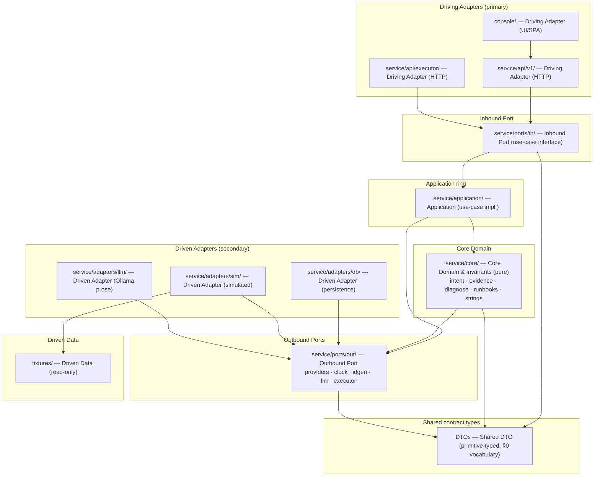

# Module 12 — Ports & Adapters

**Purpose.** Fix the hexagonal boundary rules for Module 12 so that any unit built independently lands in the same ring with the same dependency direction. Every component appears exactly once. Operations, types, ports, canonical strings, and error codes are named exactly as in `planning/detailed-design/contracts.md`; where this document introduces a stricter layer vocabulary than `contracts.md` uses, the reconciliation is stated in §4.

**Layer vocabulary (this document).**

| Tag | Meaning |
|---|---|
| `Driving Adapter` | Primary/input adapter that translates an external trigger (HTTP, UI) into a call on the Inbound Port. |
| `Inbound Port` | Use-case interface. Declares the application's operations; depends on DTOs only. |
| `Application` | Use-case implementation ring: orchestration, session registry, safety state machine, dispatch, audit writing. |
| `Core Domain` | Pure deterministic functions and invariants. No I/O, no LLM, no HTTP, no framework. |
| `Outbound Port` | Driven interface the application/core needs; implemented by a driven adapter. |
| `Driven Adapter` | Secondary/output adapter implementing an Outbound Port (persistence, simulated providers, LLM prose). |
| `Driven Data` | Read-only seed data consumed by a driven adapter. |
| `Shared DTO` | Primitive-typed request/response contract types crossing the ports. |

---

## 1. Component Table

Every component exactly once. "Depends on (allowed)" is the **only** permitted inbound dependency edge for that component; any edge not listed is a violation.

| Component (file path) | Hexagonal layer | Depends on (allowed) | Governed by (AD-n / contract) |
|---|---|---|---|
| `console/` | Driving Adapter (UI/SPA) | REST API only (`service/api/v1/`) | AD-1, AD-4 (client holds no state authority), AD-11 (render retrieved content as bounded, non-executable data), AD-13; `contracts.md` §2 routes (consumer); FR-12, FR-15 |
| `service/api/v1/` | Driving Adapter (HTTP) | Inbound Port only (`service/ports/in/`) | `contracts.md` §2 inbound routes; AD-1, AD-4/AD-5/AD-6 (destructive routes), AD-10 (one audit row per tool call), AD-13 (no mutating route outside `/api/v1/destructive/*`); R4 |
| `service/api/executor/` | Driving Adapter (HTTP) | Inbound Port only (`service/ports/in/`) | AD-15 (frozen executor contract), AD-3; `contracts.md` §2 `executor_post_proposal` / `executor_get_proposal`; R4 |
| `service/ports/in/` | Inbound Port (use-case interface) | DTOs only (`Shared DTO`) | `contracts.md` §1 + §2 operation signatures (`answer_query`, `resolve_entities`, `assemble_evidence`, `diagnose_*`, `lookup_runbook`, `propose_destructive_action`, `confirm_and_dispatch`, `create_session`…`get_audit_page`, `post_dry_run`/`post_confirm`/`get_proposal`/`post_re_dispatch`); AD-1, AD-13; R4 |
| `service/application/` | Application ring (use-case impl.) | Inbound Port + Core Domain + Outbound Port | AD-1, AD-3 (propose-only dispatch), AD-4, AD-10 (Audit Writer is single writer), AD-12, AD-15, DP-5; `contracts.md` §1 Q/I clauses; R2, R3 |
| `service/core/` (`intent`, `evidence`, `diagnose`, `runbooks`, `strings`) | Core Domain & Invariants (pure) | Outbound Port **interfaces** (never adapters) + DTO/domain types | AD-2 (determinism), AD-7, AD-8, AD-9, AD-11, AD-14, DP-5 / I-CLK-1; `contracts.md` §1 operations + §0.1/§0.4 types; `assemble_evidence` issues provider reads through the outbound provider port interfaces (R3); canonical strings single owner (`service/core/strings/canonical_strings.py`); R1, R2 |
| `service/ports/out/` (`providers`, `clock`, `idgen`, `llm`, `executor`) | Outbound Port | domain types (DTO / §0 vocabulary) | AD-1 (read-only query surface only), AD-2, AD-9, AD-13 (no control-plane method), AD-14, AD-15, DP-5; `contracts.md` §3 OP-1…OP-12 (`users_port`, `catalog_port`, `policy_port`, `groups_port`, `jobs_port`, `nodes_port`, `reservations_port`, `windows_port`, `event_store_port`, `clock_port`, `policy_content_port`, `runbook_registry_port`) plus `idgen_port` (OP-13), `llm_prose_port` (OP-14), `executor_port` (OP-15, `dispatch(request: ExecutorRequest) -> ExecutorResult`); R3, R4 |
| `service/adapters/db/` | Driven Adapter (persistence) | Outbound Port | AD-10 (append-only audit trigger, write-time redaction, 10,000-row retention cap, single writer), AD-1, AD-13; Module-12-owned stores only (Session, Answer, Evidence, Claim, ToolCall, AuditRecord, Proposal) per `contracts.md` §2.2; R3, R4 |
| `service/adapters/sim/` (mock providers, fake clock, simulated executor) | Driven Adapter (simulated) | Outbound Port | AD-1, AD-12 (typed `ok\|failure` at every read), AD-15 (simulated executor is the reference adapter); `contracts.md` §3 OP-1…OP-12 + §2 `executor_post_proposal`; data read from `fixtures/`; R3 |
| `service/adapters/llm/` | Driven Adapter (Ollama prose) | Outbound Port | AD-2 (exactly one prose call per answer, prose-only), AD-8 (prose token-scan → reject/retry, never strip), AD-11 (retrieved content only inside delimited data sections), AD-12 (`LLM_UNAVAILABLE` / `LLM_PROSE_REJECTED`); `contracts.md` §4 error catalog; R3 |
| `fixtures/` | Driven Data (read-only) | — (no code dependency; consumed by `service/adapters/sim/`) | AD-2 (reproducible snapshot → determinism), AD-12; seed values per PRD PD-5 / OQ-2; `contracts.md` §0.3 record field sets |
| `Shared DTO` (primitive-typed contract types; §0 vocabulary) | Shared DTO | — (no code dependency) | `contracts.md` §0.1–§0.5 (all-primitive types and record field sets); AD-15 (`ExecutorRequest` frozen schema); R4 |

**Explicitly not a component.** There is **no** GPU, Prometheus, vLLM, or Kubernetes adapter. Node and telemetry reads enter through the read-only provider ports (`nodes_port` OP-6; `reservations_port` OP-7; `event_store_port` OP-9). Any such adapter is an out-of-scope control-plane expansion (AD-13).

---

## 2. Hard Rules and Enforcement Points

Each rule names an enforcement point that fails mechanically — not a review rule.

### R1 — `service/core/` imports no FastAPI / DB driver / `datetime.now()` / `random` / network client

**Rule.** `service/core/` (intent, evidence, diagnose, runbooks, strings) imports only Python stdlib data types and its own modules. It must not import `fastapi`, any DB driver (`sqlite3`, `sqlalchemy`, …), `datetime`/`time` for clock reads, `random`, or any network client (`httpx`, `requests`, `urllib3`).

**Enforcement point.** A CI **static import-audit** (forbidden-imports rule, e.g. ruff `TID`/`flake8-tidy-imports` or `import-linter`) scoped to `service/core/`, failing the build on any forbidden module — the A18/I18 route-and-import audit over `service/core` and `service/application` (`contracts.md` §5 I18; ARCHITECTURE Stack Decisions "static check banning `datetime.now()`/`time.time()` in `service/core`"). Binds AD-2, AD-13, DP-5.

### R2 — Time and randomness enter only via Clock / IdGenerator ports

**Rule.** Every component with a time or id-generation rule receives the injected `clock_port` (OP-10 `now() -> ClockRead`) and/or `idgen_port`; no component reads the wall clock, calls `time.time()`, or draws from `random`/`uuid4` directly. One `ClockRead` is passed per call and reused for that turn (window calculator, dry-run `snapshot_timestamp`, audit and executor timestamps).

**Enforcement point.** (a) The R1 static import-audit bans `datetime`/`time`/`random` in `service/core` (`contracts.md` §5 I19). (b) The **frozen-clock determinism test** (`tests/determinism`, FR-14) asserts that freezing `clock_port` yields identical evidence membership, `position` sequence, citation set, `diagnosis_class`, and runbook steps across 3 runs. Binds AD-2, DP-5, I-CLK-1.

### R3 — Every external interaction sits behind an outbound port with a simulated adapter

**Rule.** All state, policy, clock, id, LLM, and executor interaction goes through an interface in `service/ports/out/`. `service/core/` and `service/application/` import only port interfaces, never adapter modules. Each outbound port has a simulated implementation in `service/adapters/sim/` (`clock_port` → fake clock, provider ports → mock providers, `executor_port` → simulated executor); `llm_prose_port` has an Ollama adapter in `service/adapters/llm/`.

**Enforcement point.** A CI **dependency/import check** (import-linter layered contract) that `service/core` and `service/application` have no import path to `service/adapters/**`; plus **fault-injection tests** (`tests/fault_injection`, FR-16) proving every port failure returns the typed `ok|failure` degradation with zero fabricated detail (`contracts.md` §5 I17; AD-12). Binds AD-1, AD-12, AD-15.

### R4 — DTOs are primitive-typed; no framework object in a DTO or port signature

**Rule.** Every DTO and every port request/response uses only the primitive vocabulary of `contracts.md` §0.1 (`QueryText`, `SessionId`, `OperatorRole`, `Instant`, `ClockRead`, `EntityKey`, `RawRef`, `Snippet`, `Page`, `PageSize`, `GateToken`, `ActionVerb`, `ReasonClass`) and the §0.3/§0.4/§0.5 record and composition types. No FastAPI `Request`/`Response`, Pydantic model instance with framework fields, ORM row, connection, or other framework object appears in a DTO or in any `service/ports/in/` or `service/ports/out/` signature.

**Enforcement point.** A **port-schema contract test** (`tests/executor_contract` for the frozen `ExecutorRequest`, extended to every port signature) asserting generated request/response schemas equal the §0 field sets exactly — extra or framework fields fail, and `contracts.md` §0.3 states "extra fields are a contract violation". Binds AD-15, `contracts.md` §0.1–§0.5.

---

## 3. Plan-2 Component Diagram (updated — every box carries its layer tag)

Updates the Plan-2 dependency-direction diagram (ARCHITECTURE.md §4.4) and the component topology (ARCHITECTURE.md §1): every box now carries its hexagonal layer tag. Arrows read **"depends on"**.

**Reads of node/telemetry.** Any operator or diagnoser read of node or fleet state flows `CORE → PORTSOUT (nodes_port OP-6 / reservations_port OP-7 / event_store_port OP-9) → ASIM → FIX`. No GPU/Prometheus/vLLM/K8s box exists in this diagram or in the component table.

---

## 4. Reconciliation and Gaps

1. **"Inbound Port" naming.** `contracts.md` §0.6 uses "Inbound Port" for the REST entrypoint (`/api/v1`, `/executor/v1`). This document uses strict hexagonal naming: the REST entrypoint is a **Driving Adapter (HTTP)** (`service/api/**`) and **Inbound Port** is reserved for the use-case interface (`service/ports/in/`). Operation and type names are unchanged; only the layer label differs.
2. **Executor HTTP route vs. outbound executor port.** `service/api/executor/` is modeled as a Driving Adapter per the folder map, while AD-15 frames the executor as an **outbound** boundary. They coincide: `service/api/executor/` is the frozen wire form of the `executor_port` adapter call; `executor_port` is now numbered **OP-15** (`dispatch(request: ExecutorRequest) -> ExecutorResult`, defined in `contracts.md` §3.1), its interface lives in `service/ports/out/`, and its reference implementation (simulated executor) lives in `service/adapters/sim/`.
3. **`idgen_port` — RESOLVED.** R2 requires ids to enter via an `idgen_port`; `contracts.md` now defines it as **OP-13** (`new_id(kind: IdKind) -> IdString`) in §3.1, with `IdKind`/`IdString` in §0.1 and `VALIDATION_BAD_ID_KIND` in §4.
4. **`llm_prose_port` — RESOLVED.** `contracts.md` now defines it as **OP-14** (`compose(prompt: ProsePrompt) -> ProseText`) in §3.1, with `ProsePrompt`/`ProseText` in §0.4, the retry-once/never-strip rule (D48), and `LLM_PROSE_REJECTED`/`LLM_UNAVAILABLE` in §4. `executor_port` is **OP-15** (`dispatch(...)`, `contracts.md` §3.1); its wire form remains `contracts.md` §2 `executor_post_proposal` / `executor_get_proposal`.
